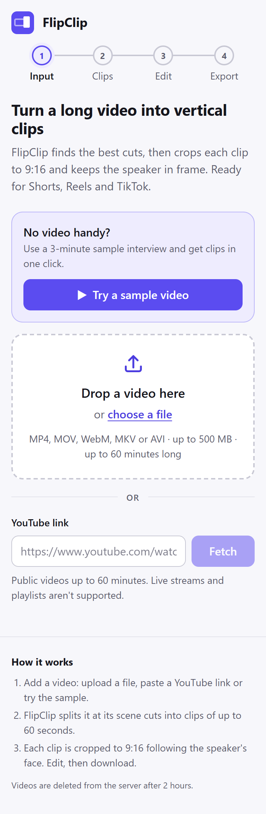
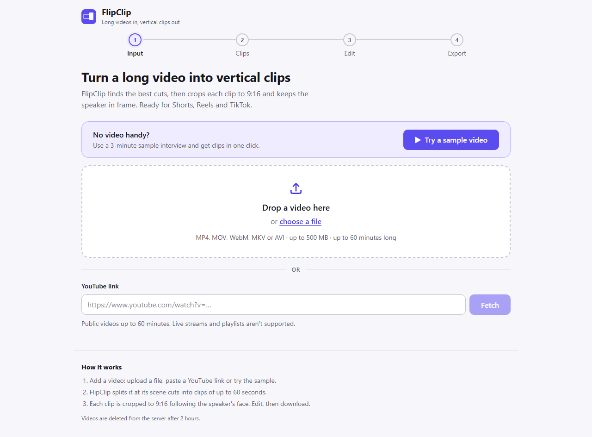
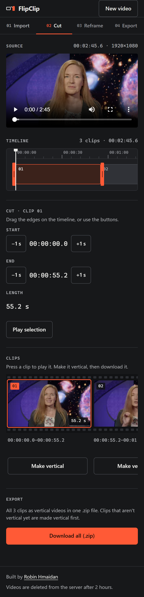
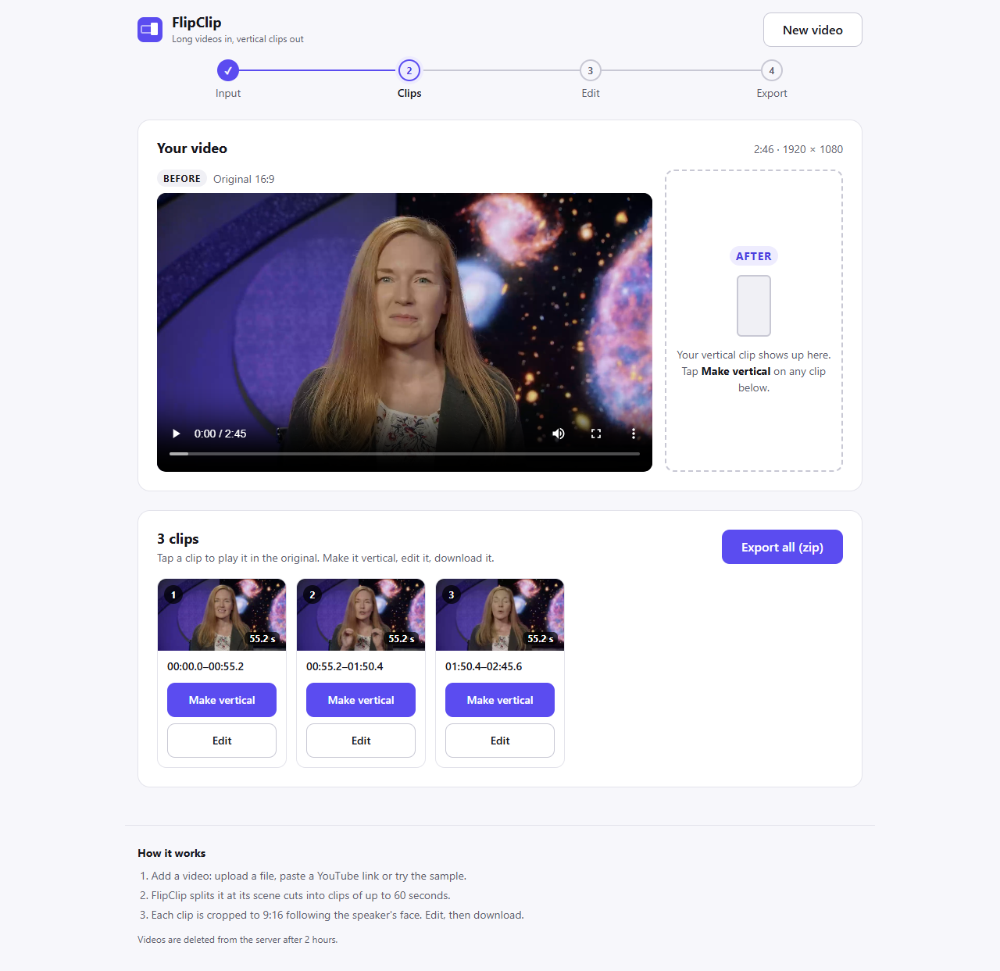
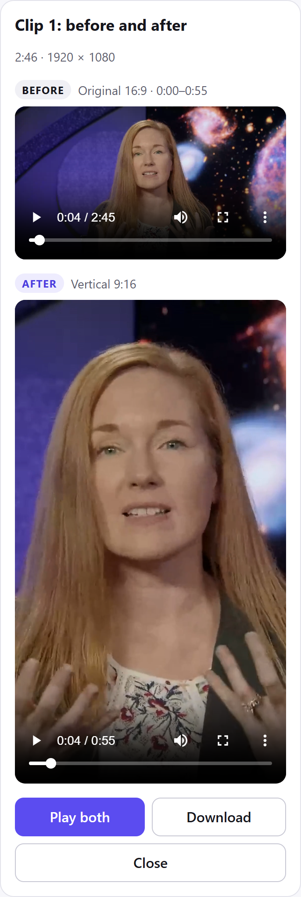
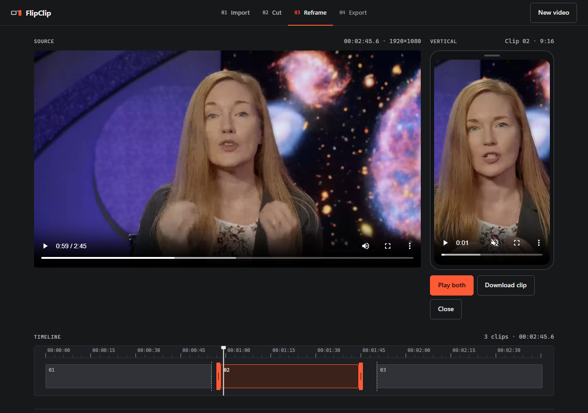
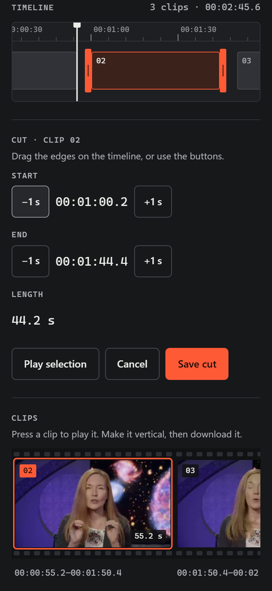
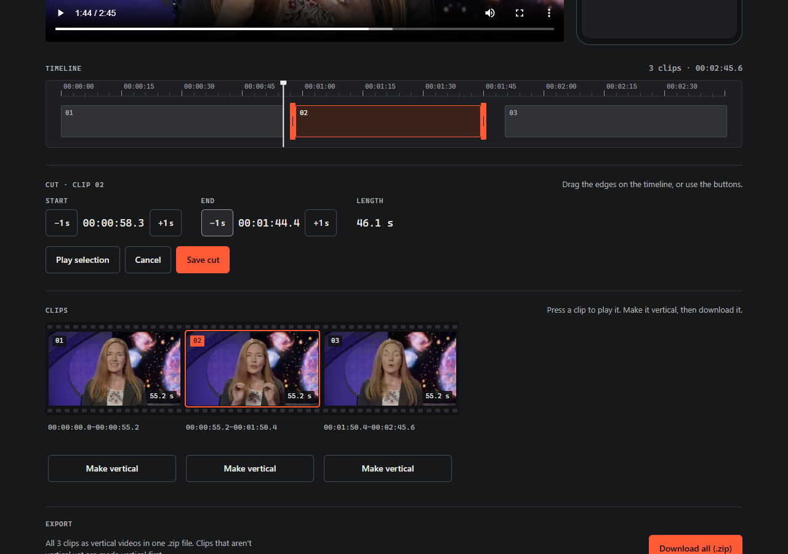
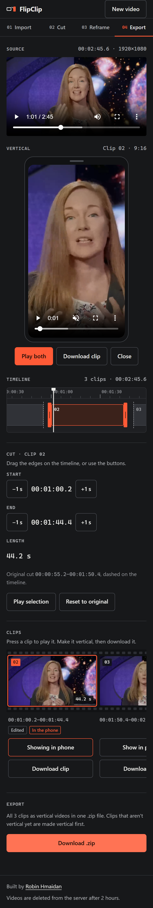
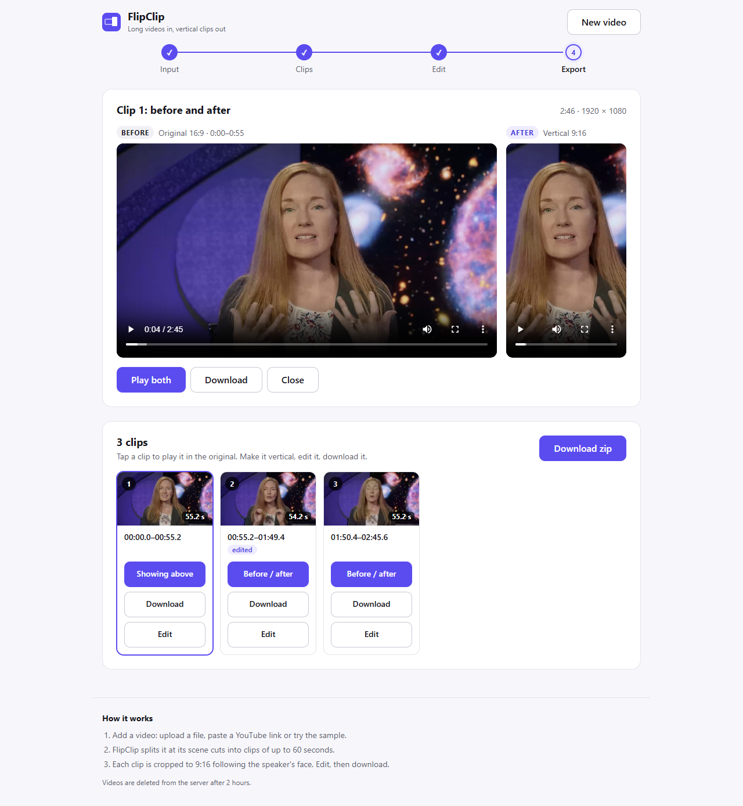

# FlipClip

FlipClip turns a long horizontal video into short vertical (9:16) clips for Shorts, Reels and TikTok,
with the frame following the speaker's face.

**Live demo: https://marvelous-pronto-unwieldy.ngrok-free.dev**

The first visit shows an ngrok notice (ngrok's free plan adds it): click **Visit Site** once.
The demo runs on my PC, so it's only up while that PC is on (see [Trade-offs](#trade-offs)).

Source: **https://github.com/Robin-Hmaidan/flipclip**

Part 2 and Part 3 answers: **[docs/ANSWERS.pdf](docs/ANSWERS.pdf)**

## Run it yourself

1. Install [Docker](https://docs.docker.com/get-docker/). Nothing else is needed.
2. Get the code and start it (the first run builds the image):
   ```bash
   git clone https://github.com/Robin-Hmaidan/flipclip
   cd flipclip
   docker compose -f docker-compose.prod.yml up
   ```
3. Open **http://localhost:7860** and click **Try the sample video**.

## What it does

The steps bar at the top follows these four steps:

1. **Import:** upload a file (up to 500 MB), paste a YouTube link, or try the bundled sample.
   Videos can be up to 60 minutes long.
2. **Cut:** it splits the video at scene changes into clips of 15–60 seconds, shown as blocks on a
   timeline under the video. Optionally drag a clip's edges to change where it starts and ends.
3. **Reframe:** "Make vertical" renders a 1080x1920 clip whose crop follows the speaker's face,
   shown in a phone frame next to the original.
4. **Export:** "Download clip" for one clip, or "Download all (.zip)" for every clip in one file.

Videos and clips are deleted automatically after about 2 hours.

## Screenshots

| Phone (375 px) | Desktop |
|---|---|
|  |  |
|  |  |
|  |  |
|  |  |
|  |  |

All shots, including the loading, error and exporting states, are in [docs/screenshots/](docs/screenshots/).

## Trade-offs

- **Jobs live in memory.** Restarting the app forgets every job, finished or not. Fine for one machine;
  more than one server would need a shared store such as Redis.
- **Hosted from my PC, not a cloud server.** The brief excludes paid services, so the app runs on my
  PC and a free ngrok tunnel makes it public. The PC must be on, and downloads are only as fast as my
  home connection's upload; the tunnel can also drop for a moment. Because it's one shared machine, it
  works on at most 3 videos at once (`MAX_ACTIVE_JOBS`) and asks you to try again in a minute when full.
- **YouTube may block cloud servers.** YouTube often refuses downloads from data-centre IP addresses,
  which is one more reason the demo runs from a home connection. Uploading a file always works.
- **The sample has no scene cuts.** It's one continuous shot, so it splits evenly (three clips of
  about 55 s) instead of at cuts. Videos with real cuts split at them.
- **The crop follows the largest face in each shot.** There is no speaker detection: in a two-person
  shot it stays on whoever's face is biggest across the shot, even while the other one talks.
- **Low-resolution sources look soft.** A vertical crop uses only a slice of the frame (608x1080 from
  a 1080p video), which is then scaled up to 1080x1920. A 360p source is scaled up much further.
- **Smaller files over perfect quality.** Clips are encoded at CRF 27 (`RENDER_CRF`): a 55 s clip is
  about 14 MB instead of 31 MB at CRF 20, and looks the same on a phone. Fine detail is slightly softer.
- **The zip doubles disk use.** "Download all (.zip)" copies every clip into the zip, so each clip is on disk
  twice until the job is deleted (about 2 hours).

## How it works

### How clips are chosen

PySceneDetect finds scene cuts. Consecutive scenes are merged until a clip reaches `MIN_CLIP_SEC`
(a short tail joins the previous clip). A clip longer than `MAX_CLIP_SEC` is split at a scene cut
when both parts stay within the limits, otherwise evenly.

### How editing works

Selecting a clip (on the timeline or in the film strip) puts a handle on each of its edges on the
timeline, which spans the whole video. Dragging a handle, or arrow keys on a focused one, moves that end
and shows its frame in the source player; ±1 s buttons and "Play selection" sit under the timeline.
"Save cut" appears once something changed. Clips are independent, so an edited
clip may overlap the next one. Its length must stay between `EDIT_MIN_SEC` (default 3 s) and
`MAX_CLIP_SEC`; the editor says why when it can't save.

Saving deletes the clip's rendered file and the export zip (neither matches any more) and redraws its
thumbnail. "Reset to original" restores segmentation's bounds. Rendering reuses the scene cuts found
at segmentation, so detection never runs again. Edits are refused (409) while that clip is waiting or
rendering, or while an export runs. Thumbnail and render URLs carry the clip's revision (`?v=`), so
the browser never shows a cached old version.

### How the vertical crop follows the face

MediaPipe (BlazeFace full-range model) looks for faces `TRACK_FPS` times per second (default 5). In
each shot the tracker follows the face with the largest total area across samples, so it doesn't jump
between people. A dead zone ignores small movements and smoothing eases larger ones; both reset at
scene cuts so a new shot snaps to its subject. With no face it holds the last position (frame centre
at the start). The crop centre is interpolated for every frame, then frames are cropped in OpenCV and
piped to ffmpeg (H.264 at `RENDER_CRF`) with the clip's original audio. A job renders one clip at a time.

### How export works

Export queues every clip that isn't rendered yet, then the zip step behind them. Its progress is the
renders' progress (95%) plus the zip copy (5%). Clips are stored in the zip uncompressed (H.264 is
already compressed), copied in 1 MB chunks. Files are named `flipclip_clip01.mp4`,
`flipclip_clip02.mp4`, … in clip order; the zip is `flipclip_clips.zip`.

### Sample video

`backend/app/assets/sample.mp4` is the three answers (20.4–85.0 s, 95.25–140.1 s, 150.3–206.4 s) of
[*Amber Straughn Canned Interview JWST 2023*](https://commons.wikimedia.org/wiki/File:NASA_Interview_Opportunity-_Celebrate_the_James_Webb_Space_Telescope%E2%80%99s_First_Year_Of_Amazing_Science_With_a_New_Observation_Live_Shots_(SVS14349_-_Amber_Straughn_Canned_Interview_JWST_2023).webm)
by NASA's Scientific Visualization Studio ([source page](https://svs.gsfc.nasa.gov/14349)), joined with the
question cards between them removed and re-encoded to H.264 1080p (2:46, 26 MB).

**License: public domain.** It is a work of the US federal government (NASA), so it carries no
copyright in the US and needs no attribution. NASA's
[media guidelines](https://www.nasa.gov/nasa-brand-center/images-and-media/) still apply: don't use
it to suggest that NASA or the person shown endorses FlipClip. The credit above is a courtesy.

`SAMPLE_VIDEO` points the route at another file; the button hides when the file is missing.

## For developers

### Development setup

```bash
docker compose up
```

Open **http://localhost:5173**. The API is at http://localhost:8000 (e.g. `/api/health`). Code changes
reload automatically. To change limits, clip lengths, render quality or CORS origins, copy
`.env.example` to `.env` and edit it.

### Tests

```bash
docker compose run --rm backend python -m pytest tests
```

### API

| Route | Purpose |
|---|---|
| `GET /api/health` | `{status, ffmpeg_version}`; status `degraded` if ffmpeg is missing |
| `GET /api/config` | upload, duration and clip-edit limits, and `sample_available`, so the UI can check before sending |
| `POST /api/jobs/upload` | multipart field `file`. 413 too big, 415 not a video, 422 too long |
| `POST /api/jobs/youtube` | `{"url": "..."}`. YouTube links only (400 otherwise); 422 too long |
| `POST /api/jobs/sample` | new job from the bundled sample video (201, `ready`); 404 if the file is missing |
| `GET /api/jobs/{id}` | `{id, status, progress, error, duration, width, height}` |
| `GET /api/jobs/{id}/video` | the stored video, for the preview |
| `POST /api/jobs/{id}/segment` | start scene detection (job must be `ready`, else 409) |
| `GET /api/jobs/{id}/clips` | `[{index, start, end, duration, original_start, original_end, edited, thumbnail_url}]` once `segmented` |
| `PATCH /api/jobs/{id}/clips/{index}` | `{"start": s, "end": e}` new bounds; returns the clip. 422 outside the video, start ≥ end, or length outside `EDIT_MIN_SEC`–`MAX_CLIP_SEC`; 409 while that clip renders or an export runs. Drops its render and the zip |
| `POST /api/jobs/{id}/clips/{index}/reset` | back to segmentation's bounds; same invalidation and 409s |
| `GET /api/jobs/{id}/clips/{index}/thumbnail` | JPEG thumbnail for one clip |
| `POST /api/jobs/{id}/clips/{index}/render` | queue a 9:16 render (202); 200 with the file if already rendered |
| `GET /api/jobs/{id}/clips/{index}` | render `{status, progress, error, video_url, download_url}` |
| `GET /api/jobs/{id}/clips/{index}/video` | the rendered 1080x1920 mp4 (seekable) |
| `GET /api/jobs/{id}/clips/{index}/download` | the same file as an attachment, `flipclip_clipNN.mp4`; 404 until rendered |
| `POST /api/jobs/{id}/export` | render the missing clips, then zip all of them (202); 200 if already exported |
| `GET /api/jobs/{id}/export` | `{status, progress, error, download_url}`; status `idle`/`rendering`/`zipping`/`done`/`failed` |
| `GET /api/jobs/{id}/export/download` | `flipclip_clips.zip`; 404 until the export is done |

All `/clips/...` and `/export...` routes answer 409 until the job is `segmented`.

Starting work (upload, YouTube, sample, segment, render, export) answers **429** with
`Retry-After: 60` while `MAX_ACTIVE_JOBS` (default 3) jobs are busy: uploading, downloading,
finding clips, rendering or exporting. A job that is already busy can still queue more renders, since
they share its one worker; finished files are always served.

A sweep runs at startup and every 30 minutes; it deletes a job once its folder hasn't changed for
2 hours and the job isn't busy.

### Production image

`docker-compose.prod.yml` builds the root `Dockerfile` (non-root uid 1000, API and built UI on
:7860), restarts it unless stopped, keeps `/data` in a named volume and pins public DNS resolvers like
the dev backend. Without Compose:

```bash
docker build -t flipclip .
docker run -p 7860:7860 flipclip
```

### Hosting the live demo

```powershell
.\scripts\start-demo.ps1            # add -NoBuild to skip rebuilding the image
```

The tunnel is the `ngrok` service in `docker-compose.prod.yml` (official `ngrok/ngrok` image, pinned),
behind the `tunnel` profile so a plain `up` never needs it. It reads the authtoken from its own
gitignored file, `.env.ngrok`, not from `.env`: the app container reads `.env`, and the token stays
out of it.

```
# .env.ngrok
NGROK_AUTHTOKEN=<your token from https://dashboard.ngrok.com/get-started/your-authtoken>
```

The script checks the token is set, starts the app and the tunnel (the tunnel waits for the app's
healthcheck), then confirms through ngrok's local API (http://127.0.0.1:4040) that the public URL is
online. Both containers restart with Docker until
`docker compose -f docker-compose.prod.yml --profile tunnel down`.

### Local setup (editor autocomplete only)

The app runs in Docker. A local venv is only for IDE autocomplete. Install in **two steps**:
scenedetect goes in with `--no-deps`, so it can't pull in a second OpenCV package.

```bash
cd backend
python -m venv .venv
.venv/Scripts/python -m pip install -r requirements.txt               # Windows (macOS/Linux: .venv/bin/python)
.venv/Scripts/python -m pip install --no-deps -r requirements-nodeps.txt
```

`pip check` will report that scenedetect needs `opencv-python`. That's expected: `opencv-contrib-python`
provides the same `cv2` module.

### Project structure

```
backend/
  app/
    main.py          FastAPI app: CORS, routers, cleanup loop, static frontend (prod)
    api/             HTTP routes: health, config, jobs
    services/        business logic: job store, uploads, ffprobe, YouTube, segmenter,
                     editor (clip bounds + invalidation), tracker (face-follow crop),
                     renderer (9:16 encode + queue), exporter (zip of all clips),
                     storage (job folders + 2-hour cleanup)
    core/config.py   settings read from env
    assets/          sample.mp4 for "Try the sample video" (public domain, see above)
  requirements.txt   pinned Python dependencies
  requirements-nodeps.txt  scenedetect, installed with --no-deps
  requirements-dev.txt     pytest + httpx (dev image only)
  tests/             pytest suite, run inside the backend container
  Dockerfile         dev backend image
frontend/            Vite + React UI (plain CSS, dark editor theme, system fonts)
docs/screenshots/    UI at 375 px and desktop, for this README
docker-compose.yml   dev: backend :8000 + Vite :5173, hot reload
docker-compose.prod.yml  production: the root Dockerfile on :7860, ngrok tunnel (profile tunnel)
Dockerfile           production: single container on :7860
scripts/start-demo.ps1   production app + ngrok tunnel containers for the live demo
```
